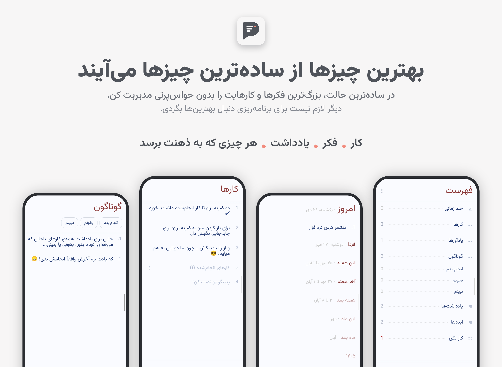

<div align="center">

# پدینگو | Padingo

**کارها، فکرها و یادداشت‌هایت را ساده، سریع و کاملاً آفلاین مدیریت کن.**

[](LICENSE)
[](https://github.com/nodahani/Padingo/releases)
[](https://github.com/nodahani/Padingo/releases)
[](https://github.com/nodahani/Padingo/stargazers)



[](https://github.com/nodahani/Padingo/releases)

</div>

<div dir="rtl">

## درباره‌ی پدینگو

پدینگو دفترچه‌ای ساده برای کارها، فکرها و یادداشت‌های توست؛ بدون حساب کاربری، بدون اینترنت و بدون حواس‌پرتی. هر صفحه‌ای با هر اسمی بساز و همه‌چیز را یک‌جا نگه دار.

نسخه‌ی فارسی و در حال توسعه‌ی [Pentastic](https://github.com/tanujnotes/Pentastic).

## ویژگی‌ها

- 📋 صفحه و زیرصفحه، با هر اسمی که بخواهی
- ⏰ یادآور با اعلان، حتی بعد از ری‌استارت گوشی
- 🔁 کارهای تکرارشونده: روزانه، هفتگی، ماهانه و سالانه
- 📅 تقویم شمسی و میلادی، با شروع هفته از شنبه، یکشنبه یا دوشنبه
- 🌗 پوسته‌ی روشن و تیره

## حریم خصوصی و پشتیبان‌گیری

پدینگو داده‌ها را در فضای محلی برنامه نگه می‌دارد. در Android، پشتیبان‌گیری سیستم برای برنامه فعال است؛ اگر پشتیبان‌گیری دستگاه روشن باشد، داده‌ها ممکن است طبق تنظیمات Android در نسخه‌ی پشتیبان یا هنگام انتقال به دستگاه دیگر کپی شوند.

## نصب

جدیدترین APK را از صفحه‌ی [Releases](https://github.com/nodahani/Padingo/releases) دانلود و نصب کن.

چون پدینگو هنوز در گوگل‌پلی نیست، اندروید هشدار «منبع ناشناس» می‌دهد. فقط برای مرورگر یا فایل‌منیجری که با آن دانلود کرده‌ای اجازه‌ی نصب را فعال کن.

## ساخت از سورس

پیش‌نیاز: JDK 17 و Android SDK (یا Android Studio)

```bash
git clone https://github.com/nodahani/Padingo.git
cd Padingo
./gradlew :composeApp:assembleDebug
```

خروجی در `composeApp/build/outputs/apk/debug/` ساخته می‌شود.

## قدردانی ❤️

پدینگو بر پایه‌ی [Pentastic](https://github.com/tanujnotes/Pentastic) ساخته شده، اثر [Tanuj (@tanujnotes)](https://github.com/tanujnotes). ممنون از ایده‌ی ساده و درخشانش!

ترجمه‌ی فارسی را از طریق [PR #10](https://github.com/tanujnotes/Pentastic/pull/10) به پروژه‌ی اصلی هم پیشنهاد داده‌ام و داخل خود اپ هم از او قدردانی کرده‌ام. شاید ساده از کنارش رد شوید، اما در این دنیای شلوغ، سازنده‌هایی مثل او نجات‌بخش‌اند.

## مجوز

پدینگو تحت مجوز **GNU AGPL-3.0** منتشر می‌شود و اثری مشتق‌شده از Pentastic است. متن کامل در [LICENSE](LICENSE) آمده و انتساب به سازنده‌ی اصلی در همین صفحه و داخل اپ حفظ شده است. اگر سازنده‌ی اصلی نکته‌ای درباره‌ی مجوز یا انتشار داشته باشد، با کمال میل همکاری می‌شود.

---

اگر پدینگو به‌دردت خورد، یک ⭐️ خیلی خوشحالم می‌کند.

</div>
